<a name="top"></a>

<p align="center">
  
</p>

<h1 align="center">Life OS</h1>

<p align="center"><b>A multi-agent workbench for one person: the protocol lives here, and so does what it accumulates.</b></p>

<p align="center"><sub>Task-grained work · agents that hand work to each other · review, annotation and memory on your own disk</sub></p>

<p align="center"><b>English</b> · <a href="./README.zh-CN.md">简体中文</a></p>

<p align="center">
  <a href="./LICENSE"></a>
  = 22.19">
  
</p>

<p align="center">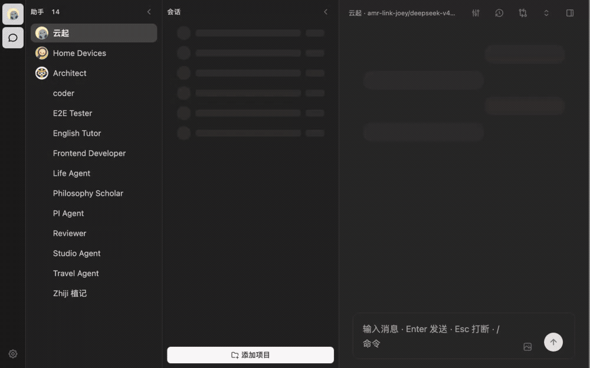</p>

## What is Life OS

Life OS is a long-running collaboration system between you and a set of AI agents. It is built from two parts: an **interaction harness protocol** (the rules and assets both sides keep to, so that "how we work" accumulates instead of being re-explained), and an **agent workbench** (the application that makes that protocol usable: tasks, review, annotation, memory).

Everything it produces stays on your disk under `~/.lifeos`. There is no account, no cloud, and no place where your sessions are shipped somewhere else.

| It is | It is not |
| --- | --- |
| A protocol for long-running collaboration with agents | A chat UI you sign into |
| Task-grained: every exchange lands in a task with its own documents | A prompt library |
| Local-first: sessions, memory and documents under `~/.lifeos` | A hosted service |
| Multi-agent: agents delegate to each other and report back | One assistant with plugins |

## How it works

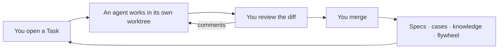

1. **A task is the unit** — it carries the goal, the plan, the log and the state, so a conversation is never the only record.
2. **Work happens in a worktree** — the agent edits a branch, not your main checkout, and its commits carry its own name.
3. **Review is where the decision lands** — one task's code diff and document diff on one screen; your comments are the handoff back.
4. **What was learned is written down** — specs, cases, knowledge and the flywheel belong to the project, not to the session that produced them.

## Features

### Turns & control

What happens inside a turn, and when you can step in.

- **Four-step status bar** — send / accept / model / done, with sub-state and elapsed time; tool calls are a sub-state of step 3 and never add steps.
- **Per-turn metrics** — tokens, context usage, speed and duration in a fixed bar; after a failure it also says how many attempts Pi already made.
- **Process folding** — a turn with dozens of tool calls collapses into one summary line while the answer stays outside it; the detail opens on click.
- **Steer, abort, compact** — `Enter` during generation pushes your message into the running turn, `Esc` aborts, `/compact` compresses the context.
- **Twelve failure kinds** — aborted / truncated / empty / timeout / network / auth / rate limit / quota / server / payload too large / model not configured / unknown, each with its own wording and next step instead of "call failed".
- **Auto-retry counter** — "retrying in Ns (i/max)" with a countdown, plus the number of attempts made once it settles.
- **Resend** — when a turn produced no result, the action bar offers "resend" on that user message; auth, quota and payload-too-large deliberately do not offer it and give an actionable next step instead.
- **Jump to latest** — scrolling up stops auto-follow; a button appears and takes you back to the bottom.

> Code: `frontend/src/working.ts` · `frontend/src/session-bar.tsx` · `frontend/src/response-bar.tsx` · `frontend/src/process-stats.ts` · `src/failure.ts`

<p align="center">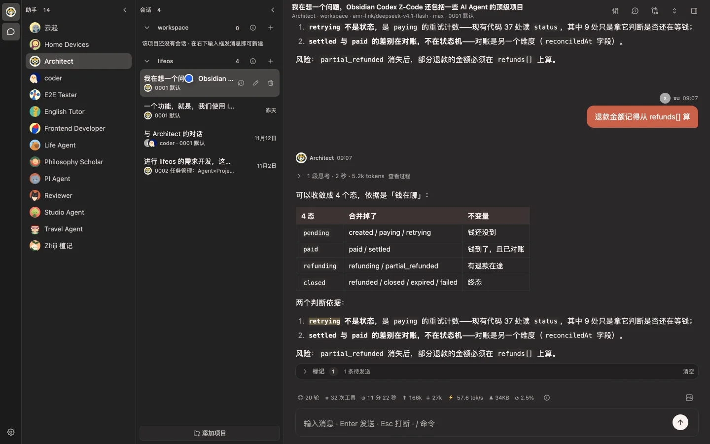</p>
<p align="center">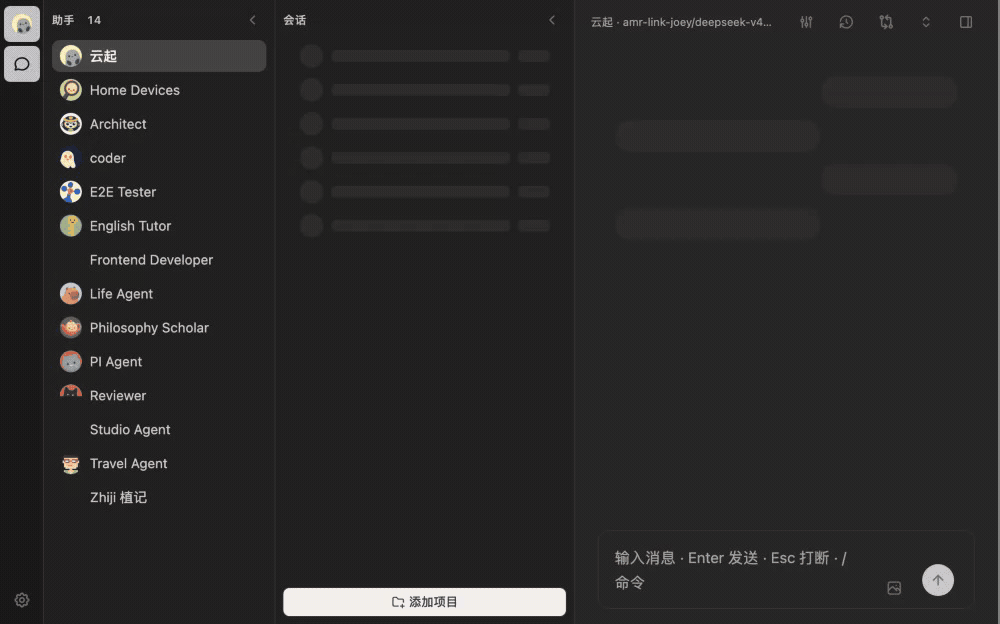</p>

### Input & editing

- **Input history** — `↑`/`↓` walks the previous messages of *this* session; it is derived from the session itself, so it survives a reload and never leaks across sessions.
- **Images** — paste, drag or pick; up to 10 per message and 10 MB each, compressed in the browser first (longest side 1024, JPEG 0.85).
- **Drafts per session** — the text you typed and the images you attached stay with that session; switching sessions does not carry them over, reloading does not lose them.
- **Eight slash commands** — `/compact` `/model` `/thinking` `/name` `/new` `/copy` `/export` `/abort`.
- **Select to copy** — releasing the mouse copies the selection and says "copied · N chars"; turn it off and you get a small toolbar instead (copy / annotate).

> Code: `frontend/src/input-history.ts` · `frontend/src/attachments.ts` · `frontend/src/copy-on-select.ts` · `frontend/src/selection-prefs.ts` · `frontend/src/App.tsx`

### Everything is traceable

- **Full history, region by region** — every request shows its system prompt split into regions: who contributed it, what change makes it move, how many tokens it costs.
- **The sent sequence and the reply** — the exact messages that went out for that turn, and what came back.
- **Peer execution panel** — when an agent talks to another agent, the other side's run is visible in a side panel rendered by the same components.
- **23 agent tools** — `lifeos_task_create`, `lifeos_task_enter`, `lifeos_ask`, `lifeos_send`, `lifeos_review_comments`, `lifeos_memory_record` and the rest; the full list is in `src/agent-tools.ts`.

> Code: `frontend/src/SessionHistory.tsx` · `frontend/src/prompt-regions.ts` · `frontend/src/prompt-patches.ts` · `frontend/src/PeerPanel.tsx` · `src/agent-tools.ts`

<p align="center">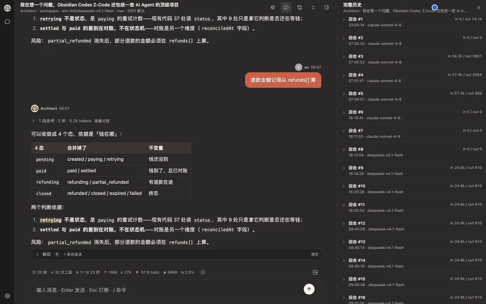</p>

### Tasks & workspaces

- **Four task types** — daily / development / general / troubleshooting; each type declares the documents it must have, so a task cannot start half-defined.
- **A workspace per task** — two git worktrees (the repository and the home directory), commits authored by the agent that made them, and the main checkout stays clean.
- **Merging is yours** — agents never merge, never delete worktrees and never rebuild your running instance; a conflict stops and waits for you.

> Code: `src/tasks.ts` · `src/task-worktree.ts` · `.lifeos/interaction-harness/protocol.md`

<p align="center">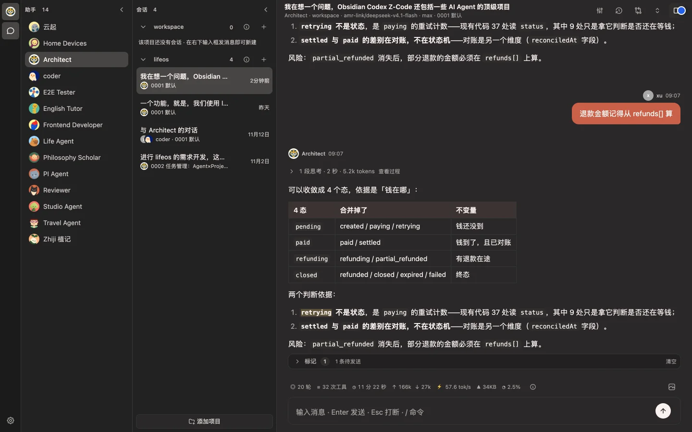</p>
<p align="center">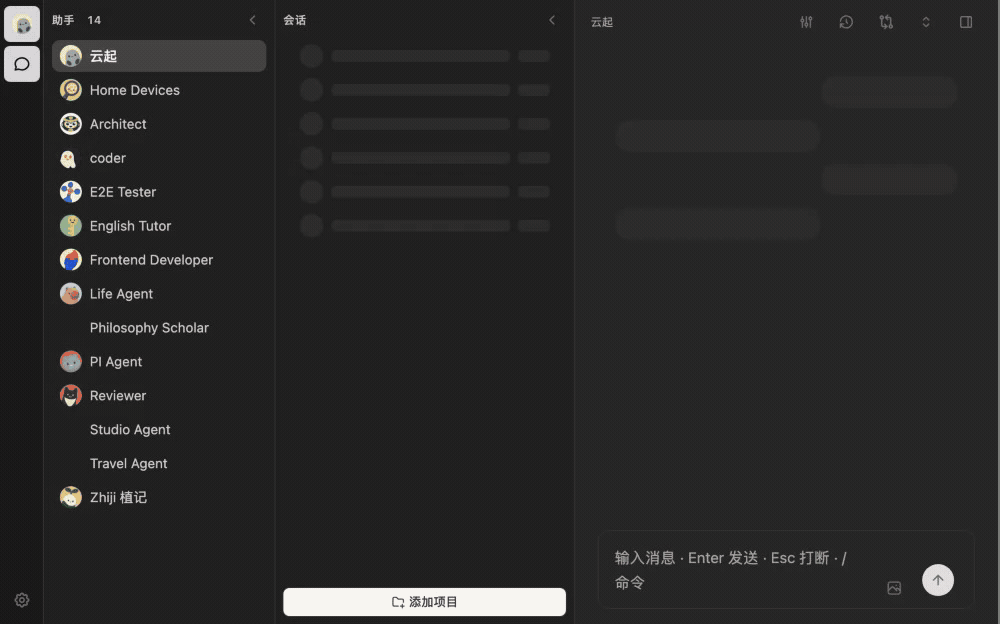</p>

### Review & annotation

- **Review mode** — one task's code diff and document diff on the same screen; comment on a line range, reply inside the thread, mark files viewed, expand large files on demand.
- **Annotations** — select text, pick a tone (question / criticism / praise / agree / archive / todo), send it as one message; the highlight stays and can be revisited.

> Code: `frontend/src/review-*.ts` · `src/review*.ts` · `frontend/src/annotations.ts` · `frontend/src/marks.ts`

<p align="center">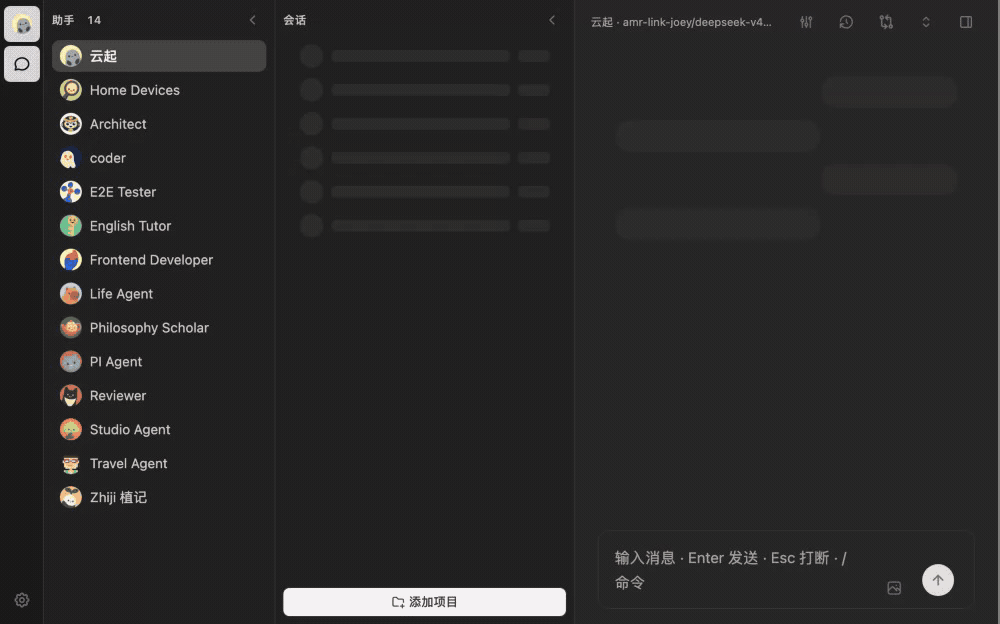</p>
<p align="center">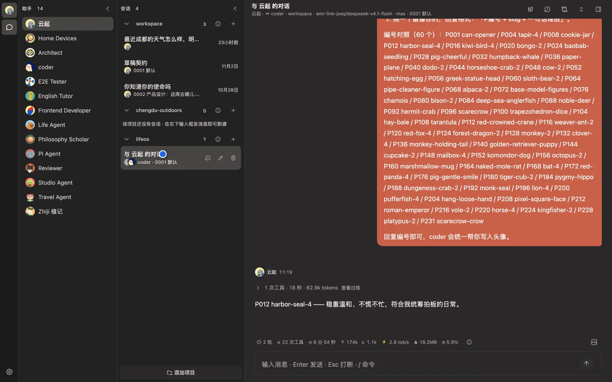</p>

### Many agents

- **Agents you can create** — one call gives an agent its own identity, workspace and default project; archiving hides it and keeps every session it ever had.
- **Agents that hand work to each other** — `lifeos_ask` waits for an answer, `lifeos_send` hands work off and delivers the reply back into the originating conversation.
- **Four layers of memory** — agent × project, project-shared, agent, user; a cross-project read can only see the project-shared layer.
- **Projects as workspaces** — bind any directory as a project; the overview card counts tasks, knowledge, cases, tools and specs for it.

> Code: `src/agents.ts` · `src/peer.ts` · `src/peer-completion.ts` · `src/memory/resolve.ts` · `src/projects.ts`

<p align="center">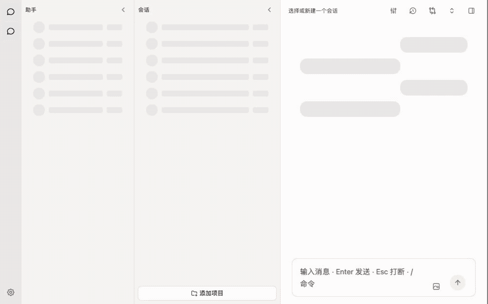</p>

### Look & feel

- **Theme engine** — one accent hue derives light and dark from the same formula; every colour is a semantic token, never a literal in a component.
- **Eight bundled themes** — four translated from VS Code, four from Obsidian, all pre-derived.
- **Import your own** — paste a VS Code theme JSON or an Obsidian CSS; it is translated, previewed, then saved as a theme pack.
- **Edit any colour** — change a value and save it as a new theme; fonts and the icon set are part of a pack too.
- **Reading width and type size** — two sliders: width from focused (about a third of the screen) to full, type size scaling the whole ramp together.
- **Status badges you can tune** — colour, breathing amplitude and period for running / done / failed, adapted for light and dark.
- **Preferences live on the server** — written to `~/.lifeos/config/ui.json` so the phone and the desktop agree; the first paint reads a local cache to avoid a flash.

> Code: `frontend/src/design/theme.ts` · `frontend/src/design/theme-translators.ts` · `frontend/src/display-prefs.ts` · `frontend/src/badge-prefs.ts` · `frontend/src/ui-prefs-client.ts`

<p align="center"></p>

### Sessions & navigation

- **Three-state counters** — running (pulsing), finished (solid green), failed (solid red), aggregated per project and per agent; a zero renders nothing.
- **Unread dot on the row** — the row's dot answers "is there something I have not seen"; the counters answer "what happened", so reading a session never deletes history.
- **Row actions** — rename, delete, and open that session's full history.
- **Columns fold and drag** — the agent column and the session column each collapse to a 44px rail; every width comes from a single `layout()` function that keeps a chat minimum.
- **Project groups with count pills** — a group header carries the count, and clicking it opens that project's overview card.

> Code: `frontend/src/status-map.ts` · `frontend/src/design/layout.ts` · `frontend/src/useColumnWidth.ts` · `frontend/src/groups-panel.tsx` · `frontend/src/design/rail.tsx`

### Files & media

- **File tree** — registered roots only; a path that resolves outside a root is rejected with 403; recent roots sort by use.
- **Viewer with two modes** — rendered or source, line wrapping, copy, multiple tabs; a file over 10k lines renders the first 10k and says so.
- **Media library** — avatars and emoji are addressed by id, so they do not consume the image budget of a message.
- **Markdown that behaves** — lazily loaded syntax highlighting, CJK-aware bold parsing, tables, and `:shortcode:` emoji.

> Code: `src/fs.ts` · `frontend/src/FileTree.tsx` · `frontend/src/FilePanel.tsx` · `src/media.ts` · `frontend/src/md-cjk.ts`

<p align="center">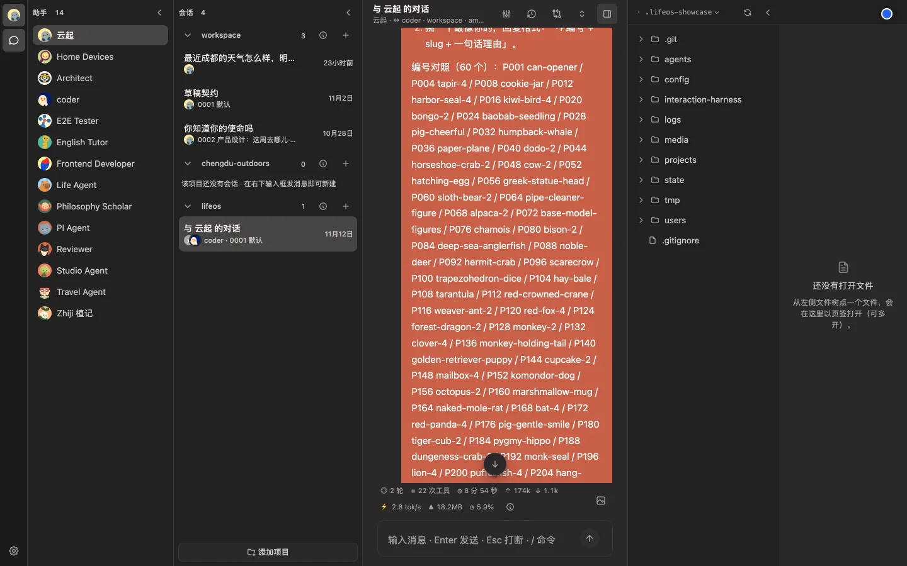</p>

### Mobile & runtime

- **Mobile layout** — a separate single-column layout below 640px with 44px touch targets and its own navigation, not a squeezed desktop.
- **Installable PWA** — service worker with three cache strategies and build-id invalidation, so a rebuild never leaves a long-lived tab on a stale bundle.
- **Reconnect instead of pretending** — a named heartbeat every 10s plus a watchdog, so a dead event stream is detected rather than looking alive.
- **Local first** — no account, no cloud; everything is under `~/.lifeos` and yours to inspect.

> Code: `frontend/src/mobile-nav.tsx` · `frontend/public/sw.js` · `frontend/src/version-banner.tsx` · `frontend/src/event-router.ts`

<p align="center">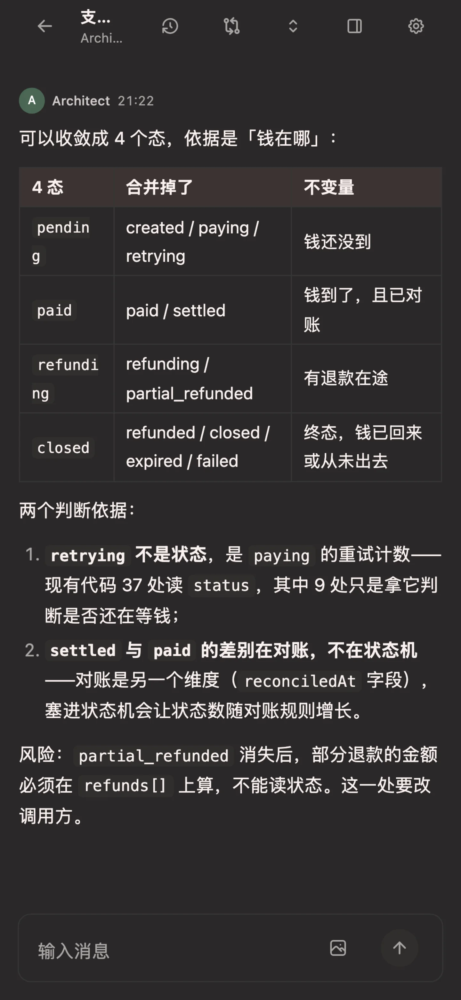</p>
<p align="center">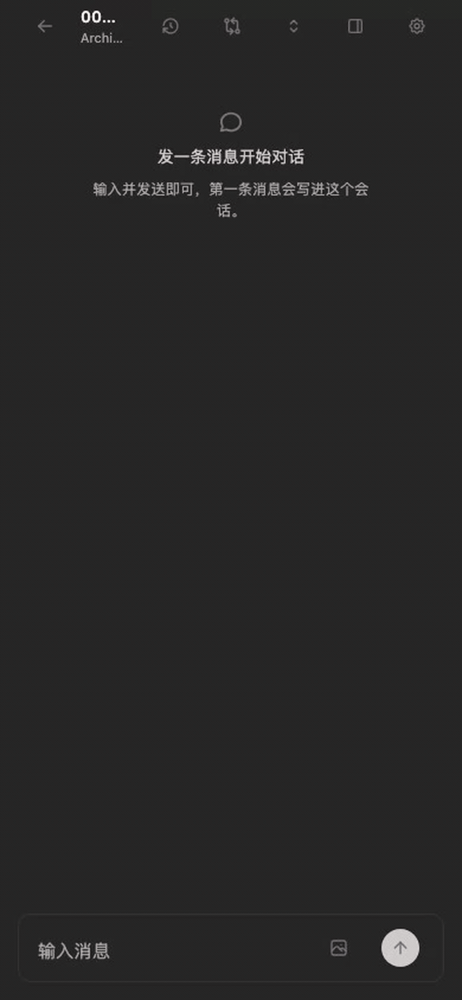</p>

## Roadmap

Designed, **not implemented**. The screenshots below are mockups, and each carries a "design, not implemented" watermark.

<p align="center">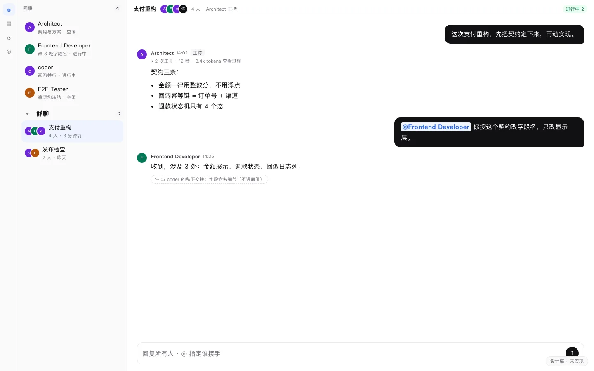</p>
<p align="center">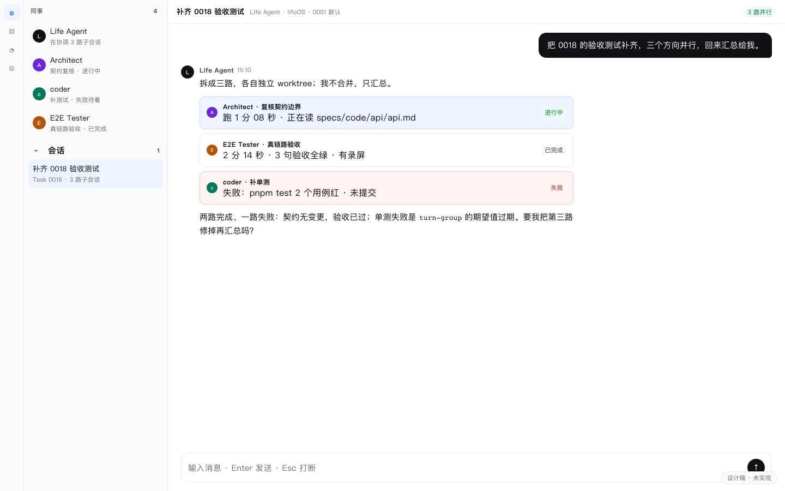</p>
<p align="center">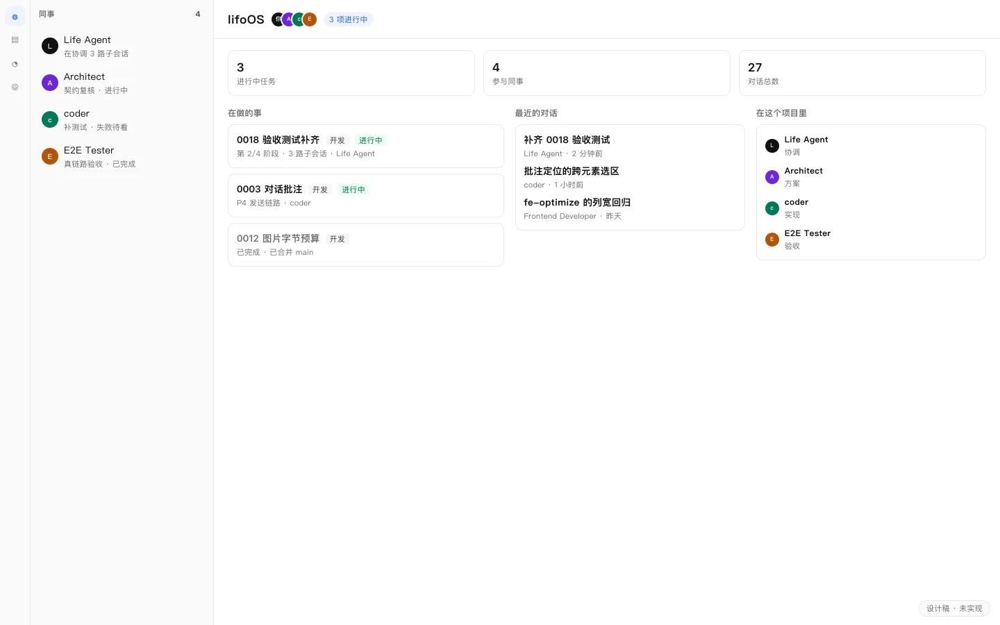</p>

| Mockup | What it would do |
| --- | --- |
| **Group chat room** | People and several agents on one persistent timeline, `@` to address one of them, handoff through a side conversation. |
| **Fan-out to several agents** | Hand one job to several agents, keep the progress and the summary inside the conversation that started it. |
| **Project workspace** | A page per project: who is in it, what they are doing, which tasks are open. |

## Quick start

| Requirement | Detail |
| --- | --- |
| Node.js | `>= 22.19.0` (`node --version`) |
| pnpm | `npm install -g pnpm` or `corepack enable pnpm` |
| A model endpoint | any OpenAI-compatible base URL and key |

```bash
# 1. Clone (pi/ is a submodule, it is required)
git clone --recurse-submodules <repo-url> && cd lifeos

# 2. Build the Pi SDK that the backend imports
npm --prefix pi ci --ignore-scripts
npm --prefix pi run hydrate:model-data     # once, needs network
npm --prefix pi run build:offline

# 3. Install this project
pnpm install

# 4. Create the home directory from the template (.lifeos/)
pnpm home:install

# 5. Point it at a model — see Configuration below, then
pnpm build && pnpm start                   # http://127.0.0.1:43120
```

Verify: `curl http://127.0.0.1:43120/api/agents` returns an agent, and the browser can send a message.

Detailed setup notes — proxy settings, `pnpm home:check`, updating the Pi SDK, and troubleshooting — are collected in `docs/getting-started.md`.

## Configuration

Two files under `~/.lifeos/config/`, both yours and both outside Git.

```jsonc
// models.json — providers and their models
{
  "providers": {
    "my-provider": {
      "baseUrl": "https://<your-endpoint>/v1",
      "apiKey": "${MY_PROVIDER_KEY}",          // environment reference also works
      "models": [{ "id": "<model-id>", "name": "<display name>" }]
    }
  }
}
```

```jsonc
// settings.json — the default the app starts with
{ "defaultProvider": "my-provider", "defaultModel": "<model-id>", "defaultThinkingLevel": "medium" }
```

| Variable | Effect |
| --- | --- |
| `LIFEOS_HOME` | Where the home directory lives. Default `~/.lifeos`. |
| `LIFEOS_API` | Base URL the dev supervisor checks. Default `http://127.0.0.1:43120`. |

The format is the same as Pi's (`pi/packages/coding-agent/docs/models.md`).

## Development

| Command | What it does |
| --- | --- |
| `pnpm dev:all` | Backend with restart-on-change (waits for a running turn) plus the Vite dev server |
| `pnpm dev` / `pnpm dev:web` | Backend and frontend separately |
| `pnpm build && pnpm start` | Build once, then serve from `dist/server.mjs` |
| `pnpm stop` | Stop the backend (43120) and the dev server (5173) |
| `pnpm home:check` | Validate the home directory structure (read-only) |
| `pnpm verify` | The full gate: typecheck, lint, backend tests, UI contracts, mobile, drafts, PWA |

Rules for contributing code live in [`AGENTS.md`](./AGENTS.md), which also maps each kind of change to the documents to read first.

## Docs

```
lifeos/
├─ src/          backend: HTTP, sessions, prompt assembly, tasks, review
├─ frontend/     browser app (Vite + React), built to static files
├─ pi/           Pi SDK source (git submodule, used as source)
├─ .lifeos/      home-directory template: protocol, agents, projects, knowledge
└─ test/         backend tests
```

| Where | What |
| --- | --- |
| [`.lifeos/interaction-harness/protocol.md`](./.lifeos/interaction-harness/protocol.md) | The protocol itself: tasks, layers, memory, review |
| [`.lifeos/projects/lifeos/knowledge/`](./.lifeos/projects/lifeos/knowledge/) | System facts: architecture, designs, requirements |
| [`.lifeos/projects/lifeos/specs/`](./.lifeos/projects/lifeos/specs/) | Binding rules for code, API, testing and review |
| [`AGENTS.md`](./AGENTS.md) | Where to start for each kind of change |

> [!NOTE]
> The protocol, specs and knowledge base are currently written in Chinese. The README is the English entry point.

## Sponsor

If this is useful to you, you can buy me a coffee. <!-- FUNDING 链接待用户提供（D3） -->

## License

[MIT](./LICENSE)

<p align="right"><a href="#top">Back to top</a></p>
