<a name="top"></a>

<p align="center">
  
</p>

<h1 align="center">Life OS</h1>

<p align="center"><b>给一个人的多 Agent 工作台：协议长在这里，沉淀也长在这里。</b></p>

<p align="center"><sub>以 Task 为工作粒度 · Agent 之间能互相派活 · 检视、批注与记忆都落在你自己的磁盘上</sub></p>

<p align="center"><a href="./README.md">English</a> · <b>简体中文</b></p>

<p align="center">
  <a href="./LICENSE"></a>
  = 22.19">
  
</p>

<p align="center">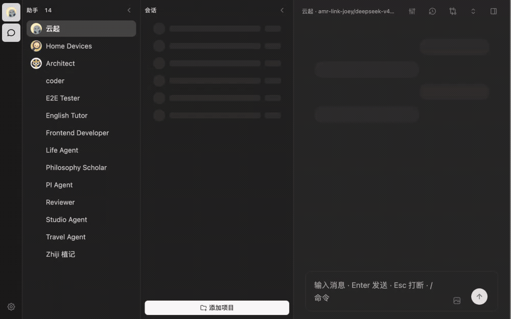</p>

## 它是什么

Life OS 是你和一组 AI Agent 长期协作的系统，由两部分组成：**交互 harness 协议**（双方共同遵守的规则与资产，让「怎么协作」被积累下来，而不是每次重新解释）和**Agent 工作台**（把这套协议变成可用的应用：任务、检视、批注、记忆）。

它产出的一切都在你的磁盘上（`~/.lifeos`）：没有账号、没有云端，也没有哪个环节会把你的会话发到别处。

| 它是 | 它不是 |
| --- | --- |
| 一套与 Agent 长期协作的协议 | 一个要登录的聊天界面 |
| 以 Task 为粒度：每次交互都落进一个任务，任务带自己的文档 | 一个提示词库 |
| 本地优先：会话、记忆、文档都在 `~/.lifeos` | 一个托管服务 |
| 多 Agent：Agent 之间会互相派活并回执 | 一个装插件的助手 |

## 它怎么工作

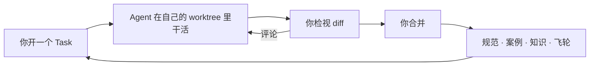

1. **Task 是单位** — 它承载目标、计划、日志与状态，所以对话永远不是唯一的记录。
2. **改动发生在 worktree 里** — Agent 改的是分支，不是你的主工作区；提交带它自己的署名。
3. **检视是决定落地的地方** — 同一个 Task 的代码 diff 与文档 diff 摊在同一屏，你的评论就是回给它的交接。
4. **学到的东西会被写下来** — 规范、案例、知识与飞轮属于项目，不属于产生它的那次会话。

## 特性

### 对话与回合控制

一轮里发生了什么，以及什么时候你能插手。

- **4 步状态条** — 发送 / 受理 / 模型处理 / 完成，带子状态与耗时；工具调用是第 3 步的子状态，不增加大步骤。
- **本轮指标** — 固定状态条里显示 token、上下文占比、速度与耗时；失败后还会说明 Pi 已经自动试了几次。
- **过程折叠** — 一轮里几十次工具调用收成一行统计，正文留在外面；要看细节再点开。
- **插话 / 打断 / 压缩** — 生成中按 `Enter` 把话插进当前回合、`Esc` 打断、`/compact` 压缩上下文。
- **12 类失败归因** — 中断 / 截断 / 空回复 / 超时 / 网络 / 鉴权 / 限流 / 配额 / 服务端 / 载荷过大 / 模型未配置 / 未知，各有各的文案与下一步，不出现「调用失败」四个字。
- **自动重试计数** — 「Ns 后重试（i/max）」带倒计时；结束后还能看到总共试了几次。
- **重新发送** — 一轮没跑出结果时，那条用户消息的动作条上有「重新发送」；鉴权 / 配额 / 载荷过大三类故意不给它，而是给一条能执行的出路。
- **回到底部** — 上滑离开底部就停止自动跟随，右下角出现按钮，点一下回到最新并恢复跟随。

> 代码：`frontend/src/working.ts` · `frontend/src/session-bar.tsx` · `frontend/src/response-bar.tsx` · `frontend/src/process-stats.ts` · `src/failure.ts`

<p align="center">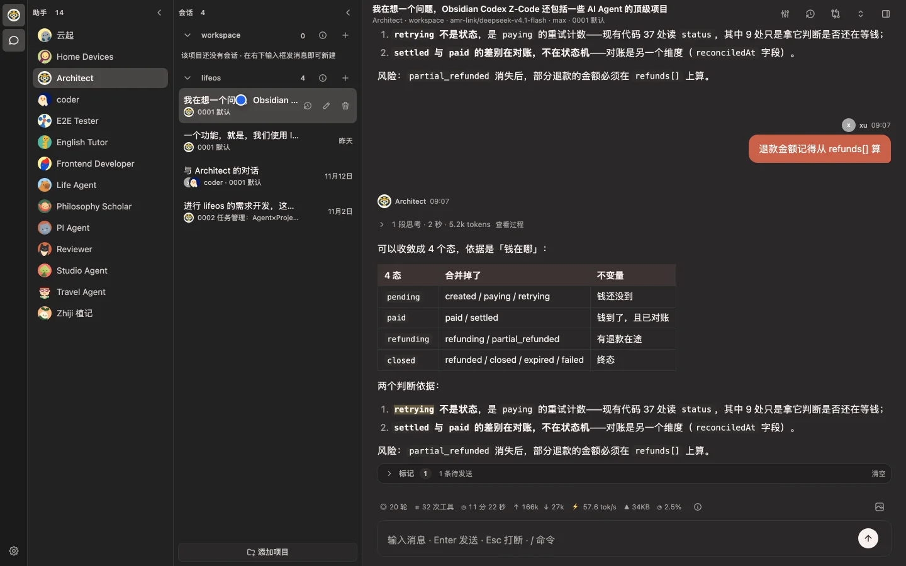</p>
<p align="center">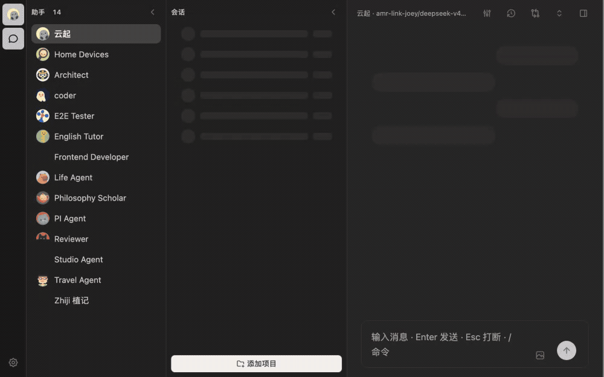</p>

### 输入与编辑

- **输入历史** — `↑`/`↓` 走的是**这个会话**以前发过的消息；历史从会话本身派生，所以刷新不丢、也不会串到别的会话。
- **图片输入** — 粘贴、拖拽或选取；一条消息最多 10 张、单张最大 10MB，先在浏览器里压缩（最长边 1024、JPEG 0.85）。
- **草稿按会话隔离** — 你打的字和挂的图跟着那个会话走；切会话不会带过去，刷新也不会丢。
- **8 个斜杠命令** — `/compact` `/model` `/thinking` `/name` `/new` `/copy` `/export` `/abort`。
- **选中即复制** — 松开鼠标就复制并提示「已复制 · N 字」；关掉之后改弹出小工具条（复制 / 批注）。

> 代码：`frontend/src/input-history.ts` · `frontend/src/attachments.ts` · `frontend/src/copy-on-select.ts` · `frontend/src/selection-prefs.ts` · `frontend/src/App.tsx`

### 全程可追溯

- **完整历史，按分区看** — 每次请求的系统提示被拆成分区：谁加的、改哪里会让它变动、占多少 token。
- **发出的消息序列与回复** — 那一轮实际发出去的每条消息，以及回来的内容。
- **对端执行面板** — Agent 与另一个 Agent 对话时，对端那一路的执行过程在侧栏可见，用的是同一套渲染组件。
- **23 个 Agent 工具** — `lifeos_task_create`、`lifeos_task_enter`、`lifeos_ask`、`lifeos_send`、`lifeos_review_comments`、`lifeos_memory_record` 等，完整清单在 `src/agent-tools.ts`。

> 代码：`frontend/src/SessionHistory.tsx` · `frontend/src/prompt-regions.ts` · `frontend/src/prompt-patches.ts` · `frontend/src/PeerPanel.tsx` · `src/agent-tools.ts`

<p align="center">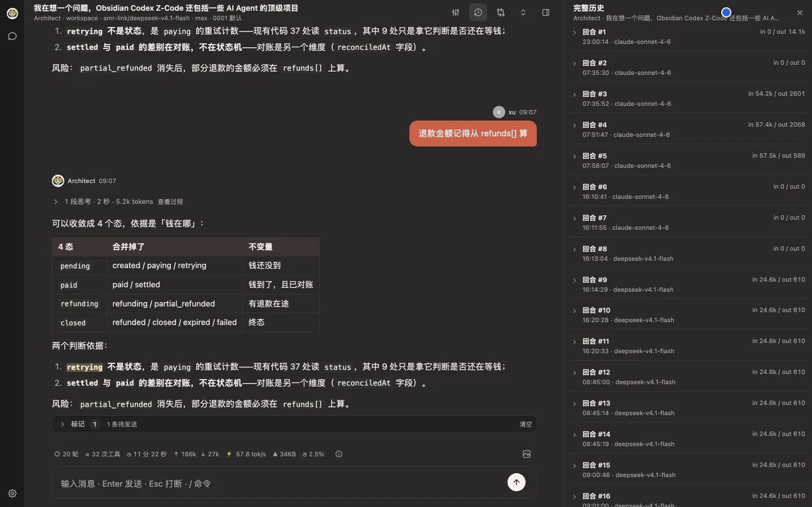</p>

### Task 与工作区

- **4 种任务类型** — 日常 / 开发 / 普通 / 问题定位修复；每种类型声明它必须有哪些文档，任务没法「只写一半」就开工。
- **每个 Task 一个工作区** — 两个 git worktree（项目仓与家目录仓），提交署 Agent 自己的名字，主工作区保持干净。
- **合并由你触发** — Agent 不自动合并、不删工作区、不重建你正在用的实例；冲突就停下来等你。

> 代码：`src/tasks.ts` · `src/task-worktree.ts` · `.lifeos/interaction-harness/protocol.md`

<p align="center">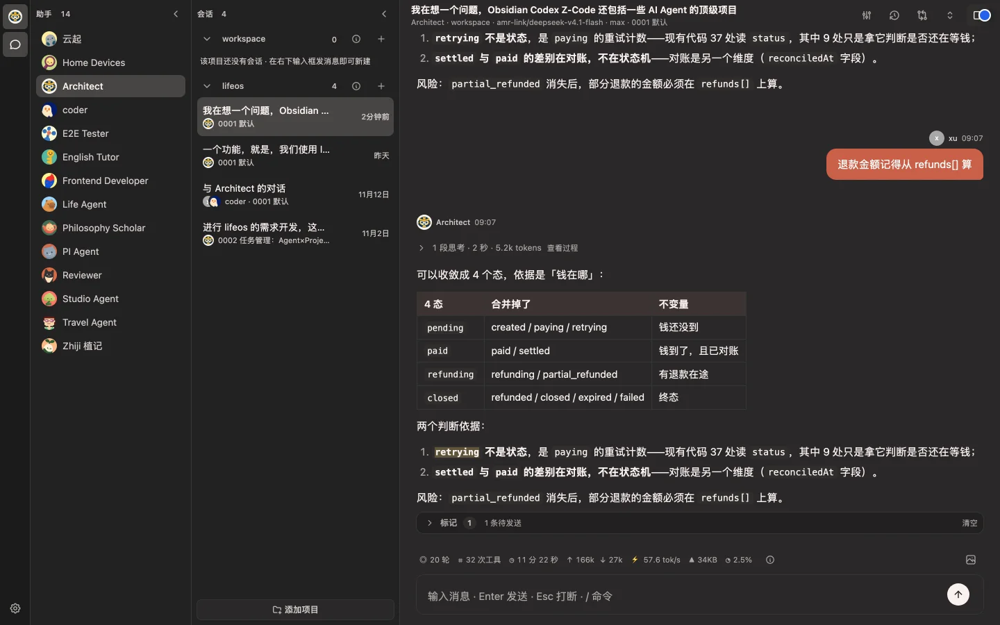</p>
> Task 的改动落在它自己的工作区里，主工作区保持干净。（不配图：演示环境里没有真的 git worktree。）

### 检视与批注

- **检视模式** — 同一个 Task 的代码 diff 与文档 diff 在同一屏；可以按行范围评论、在线程里回复、把文件标为已看、大文件按需展开。
- **批注** — 选中一段文字，选一个语气（疑问 / 批评 / 鼓励 / 同意 / 存档 / 待办），作为一条消息发出去；高亮留在原位，随时回看。

> 代码：`frontend/src/review-*.ts` · `src/review*.ts` · `frontend/src/annotations.ts` · `frontend/src/marks.ts`

<p align="center">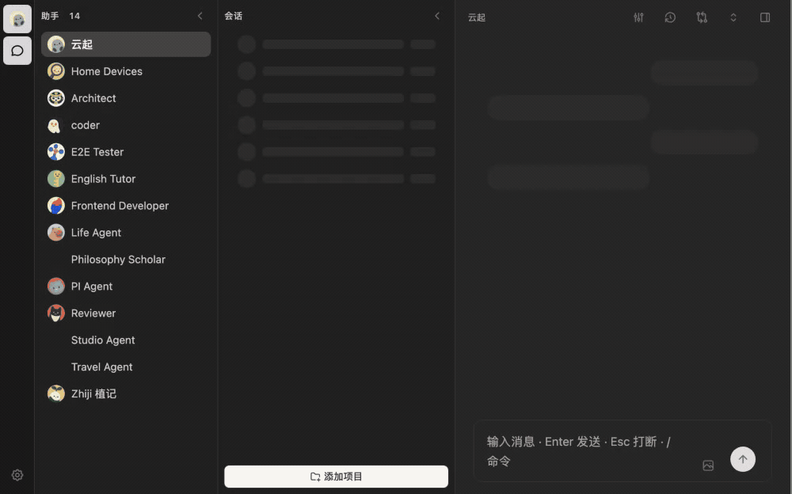</p>
<p align="center">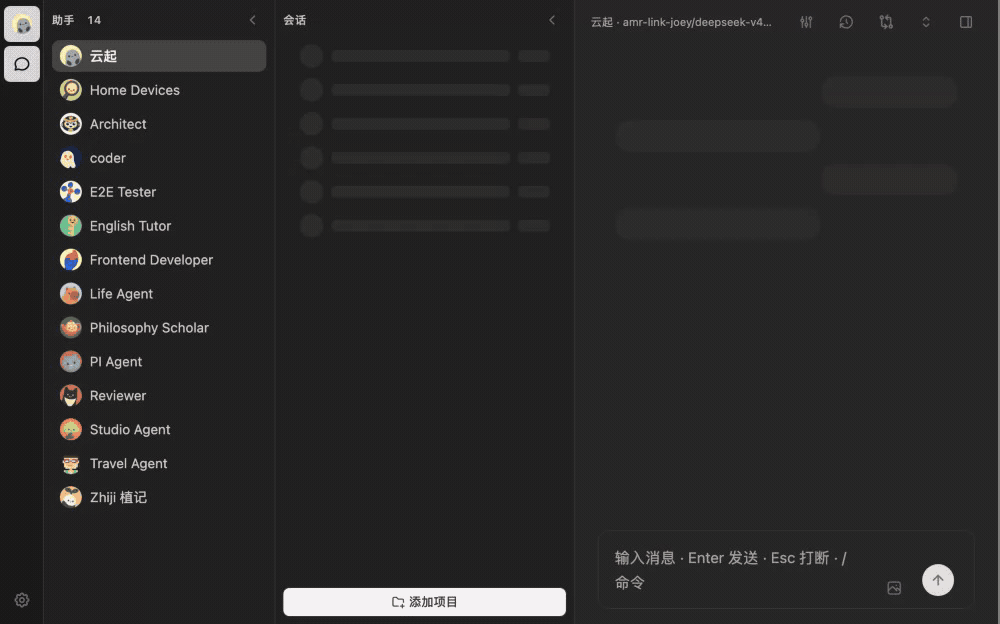</p>

### 多 Agent

- **能新建的 Agent** — 一次调用就给一个 Agent 自己的身份、工作区与默认项目；归档只是隐藏，它所有会话都保留。
- **Agent 之间能派活** — `lifeos_ask` 问一句并等回复，`lifeos_send` 把活交出去，完成后的回执注入发起那条会话。
- **四层记忆** — Agent × 项目 / 项目共享 / Agent / 用户；跨项目读取只能看到项目共享那一层。
- **项目即工作区** — 把任意目录绑成项目；概览卡会数出它的任务、知识、案例、工具与规范。

> 代码：`src/agents.ts` · `src/peer.ts` · `src/peer-completion.ts` · `src/memory/resolve.ts` · `src/projects.ts`

<p align="center">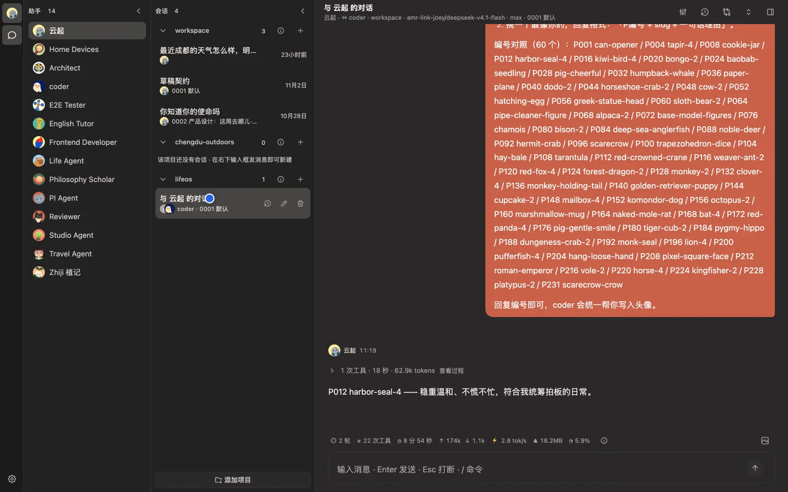</p>
<p align="center">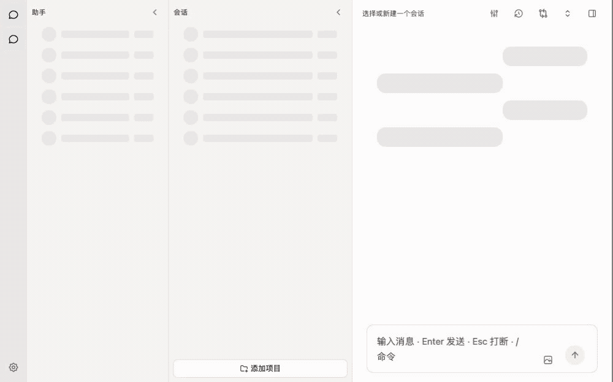</p>

### 外观与偏好

- **主题引擎** — 一个主色相用同一套公式派生出深浅两套；每个颜色都是语义令牌，组件里不写字面量。
- **8 套内置主题** — 4 套译自 VS Code，4 套译自 Obsidian，全部预先派生好。
- **导入你自己的** — 粘贴一份 VS Code 主题 JSON 或 Obsidian CSS，经转译、预览，再保存成一个主题包。
- **改任意颜色** — 调一个值就保存为新主题；字体与图标集也在主题包里。
- **阅读宽度与字号** — 两个滑块：宽度从专注（约 1/3 屏）到铺满，字号整组字阶等比缩放。
- **状态徽标可调** — 运行 / 完成 / 失败的颜色、呼吸幅度与周期都能调，深浅色各自适配。
- **偏好存在服务端** — 写进 `~/.lifeos/config/ui.json`，手机与桌面一致；首帧读本地缓存，避免闪一下。

> 代码：`frontend/src/design/theme.ts` · `frontend/src/design/theme-translators.ts` · `frontend/src/display-prefs.ts` · `frontend/src/badge-prefs.ts` · `frontend/src/ui-prefs-client.ts`

<p align="center"></p>

### 会话与导航

- **三态计数** — 正在跑（呼吸）、正常结束（固定绿）、异常结束（固定红），按项目与助手两层聚合；零值不渲染。
- **会话行的未读点** — 行上的点回答「有没有我没看的」，计数回答「发生过什么」；所以看过一个会话不会把历史抹掉。
- **行内动作** — 重命名、删除、打开这个会话的完整历史。
- **列可折叠也可拖宽** — 助手列与会话列各自能收成 44px 的导航轨；所有宽度由同一个 `layout()` 算出并保住聊天最小宽度。
- **项目分组与计数药丸** — 分组头带计数，点开是这个项目的概览卡。

> 代码：`frontend/src/status-map.ts` · `frontend/src/design/layout.ts` · `frontend/src/useColumnWidth.ts` · `frontend/src/groups-panel.tsx` · `frontend/src/design/rail.tsx`

### 文件与素材

- **文件树** — 只认已注册的根；解析后落在根外的路径一律 403；打开过的根按最近使用排序。
- **查看器两档** — 渲染或源码、自动换行、复制、多页签；超过 1 万行的文件只渲染前 1 万行并明说。
- **媒体库** — 头像与表情按 id 引用，不占一条消息的图片预算。
- **Markdown 不乱** — 语法高亮懒加载、CJK 友好的粗体解析、表格、`:shortcode:` 表情。

> 代码：`src/fs.ts` · `frontend/src/FileTree.tsx` · `frontend/src/FilePanel.tsx` · `src/media.ts` · `frontend/src/md-cjk.ts`

<p align="center">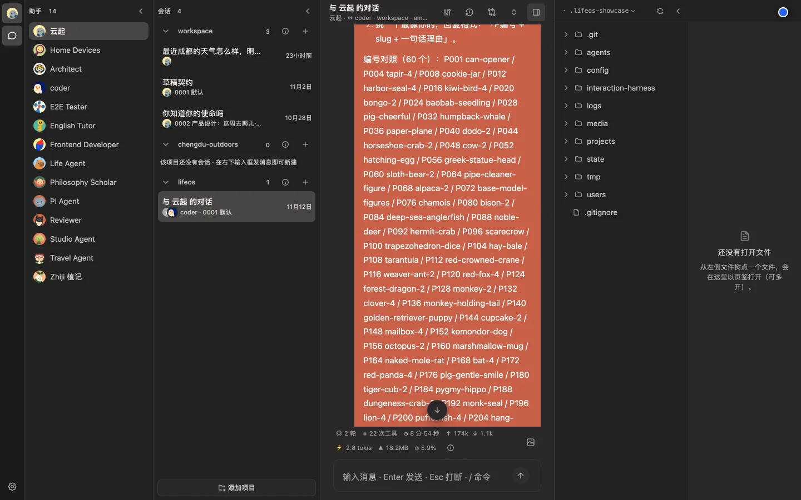</p>

### 手机与运行

- **手机布局** — 640px 以下是独立的单列布局、44px 触控目标和自己的导航，不是把桌面压窄。
- **可安装的 PWA** — service worker 三档缓存、构建号失效、「有新版本」提示条。
- **重连而不是假装活着** — 每 10 秒一条具名心跳加看门狗，事件流断了能被发现，而不是看着像活着。
- **本地优先** — 没有账号、没有云；一切都在 `~/.lifeos`，你随时可以翻。

> 代码：`frontend/src/mobile-nav.tsx` · `frontend/public/sw.js` · `frontend/src/version-banner.tsx` · `frontend/src/event-router.ts`

<p align="center">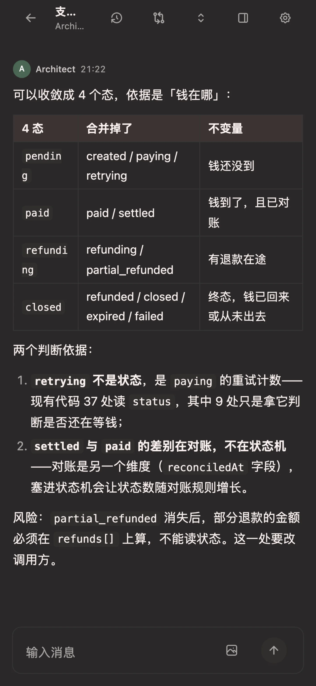</p>
<p align="center"></p>

## 路线图

已设计，**尚未实现**。下面的图都是设计稿，每张带「设计稿 · 未实现」水印。

<p align="center">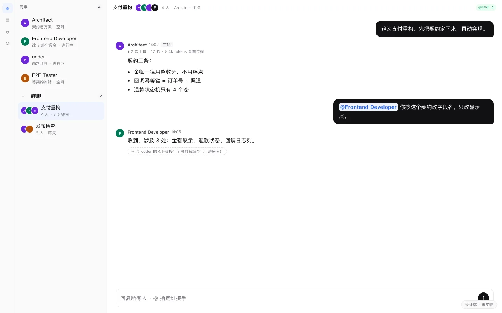</p>
<p align="center">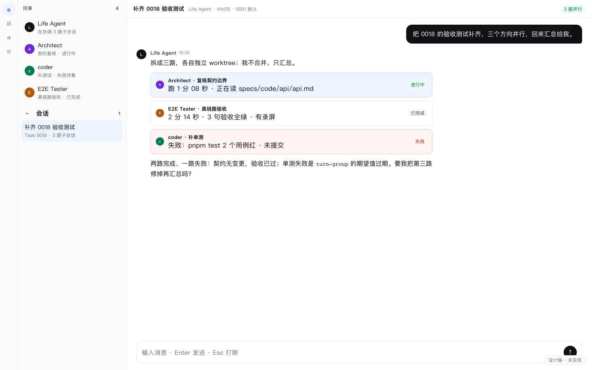</p>
<p align="center">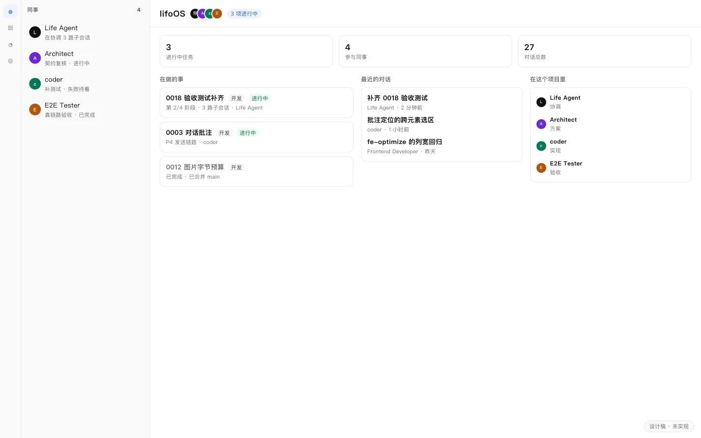</p>

| 设计稿 | 它会做什么 |
| --- | --- |
| **群聊房间** | 人与几个 Agent 在同一条持久时间线上，用 `@` 指定其中一个，handoff 走侧边会话。 |
| **一次派给多个 Agent** | 一件事交给几个 Agent 并行，进度与汇总都留在发起的那个会话里。 |
| **项目工作台** | 每个项目一页：项目里有谁、在干什么、有哪些任务开着。 |

## 快速开始

| 要求 | 说明 |
| --- | --- |
| Node.js | `>= 22.19.0`（`node --version`） |
| pnpm | `npm install -g pnpm` 或 `corepack enable pnpm` |
| 模型服务 | 任意 OpenAI 兼容的 base URL 与密钥 |

```bash
# 1. 克隆（pi/ 是子模块，必须一起拿）
git clone --recurse-submodules <仓库地址> && cd lifeos

# 2. 构建后端 import 的 Pi SDK
npm --prefix pi ci --ignore-scripts
npm --prefix pi run hydrate:model-data     # 首次需要联网
npm --prefix pi run build:offline

# 3. 安装本项目依赖
pnpm install

# 4. 从模板（.lifeos/）搭出家目录
pnpm home:install

# 5. 指向一个模型（见下方「配置」），然后
pnpm build && pnpm start                   # http://127.0.0.1:43120
```

验证：`curl http://127.0.0.1:43120/api/agents` 能返回一个 Agent，浏览器里能发消息。

更细的安装说明（代理配置、`pnpm home:check`、两种运行模式、更新 Pi SDK、常见问题）收在 **[docs/getting-started.md](./docs/getting-started.md)**。

## 配置

两个文件都在 `~/.lifeos/config/` 下，都是你自己的，也都不进 Git。

```jsonc
// models.json —— provider 与模型清单
{
  "providers": {
    "my-provider": {
      "baseUrl": "https://<你的服务>/v1",
      "apiKey": "${MY_PROVIDER_KEY}",          // 也可以用环境变量引用
      "models": [{ "id": "<模型 id>", "name": "<显示名>" }]
    }
  }
}
```

```jsonc
// settings.json —— 应用启动时的默认值
{ "defaultProvider": "my-provider", "defaultModel": "<模型 id>", "defaultThinkingLevel": "medium" }
```

| 环境变量 | 作用 |
| --- | --- |
| `LIFEOS_HOME` | 家目录位置，默认 `~/.lifeos`。 |
| `LIFEOS_API` | 开发 supervisor 检查的后端地址，默认 `http://127.0.0.1:43120`。 |

格式与 Pi 一致（`pi/packages/coding-agent/docs/models.md`）。

## 开发

| 命令 | 做什么 |
| --- | --- |
| `pnpm dev:all` | 后端（改代码先等在跑的回合结束再重启）加 Vite 开发服务器 |
| `pnpm dev` / `pnpm dev:web` | 前后端分开起 |
| `pnpm build && pnpm start` | 构建一次，之后从 `dist/server.mjs` 启动 |
| `pnpm stop` | 结束后端（43120）与开发前端（5173） |
| `pnpm home:check` | 校验家目录结构（只读） |
| `pnpm verify` | 全套门禁：类型、lint、后端测试、界面契约、手机、草稿、PWA |

改代码要遵守的规则在 [`AGENTS.md`](./AGENTS.md)，那里也按「改什么」列出了先读哪些文档。

## 文档

```
lifeos/
├─ src/          后端：HTTP、会话、prompt 装配、任务、检视
├─ frontend/     浏览器界面（Vite + React），构建为静态产物
├─ pi/           Pi SDK 源码（git 子模块，以源码方式使用）
├─ .lifeos/      家目录模板：协议、Agent、项目、知识库
└─ test/         后端测试
```

| 位置 | 内容 |
| --- | --- |
| [`.lifeos/interaction-harness/protocol.md`](./.lifeos/interaction-harness/protocol.md) | 协议正文：Task、层级、记忆、检视 |
| [`.lifeos/projects/lifeos/knowledge/`](./.lifeos/projects/lifeos/knowledge/) | 系统事实：架构、设计、需求 |
| [`.lifeos/projects/lifeos/specs/`](./.lifeos/projects/lifeos/specs/) | 代码、接口、测试、检视的约束条文 |
| [`AGENTS.md`](./AGENTS.md) | 每一类改动的入口地图 |

> [!NOTE]
> 协议、规范与知识库目前是中文写的；英文入口是 README。

## 赞助

如果这套东西对你有用，可以请我喝杯咖啡。 <!-- FUNDING 链接待用户提供（D3） -->

## 许可

[MIT](./LICENSE)

<p align="right"><a href="#top">回到顶部</a></p>
